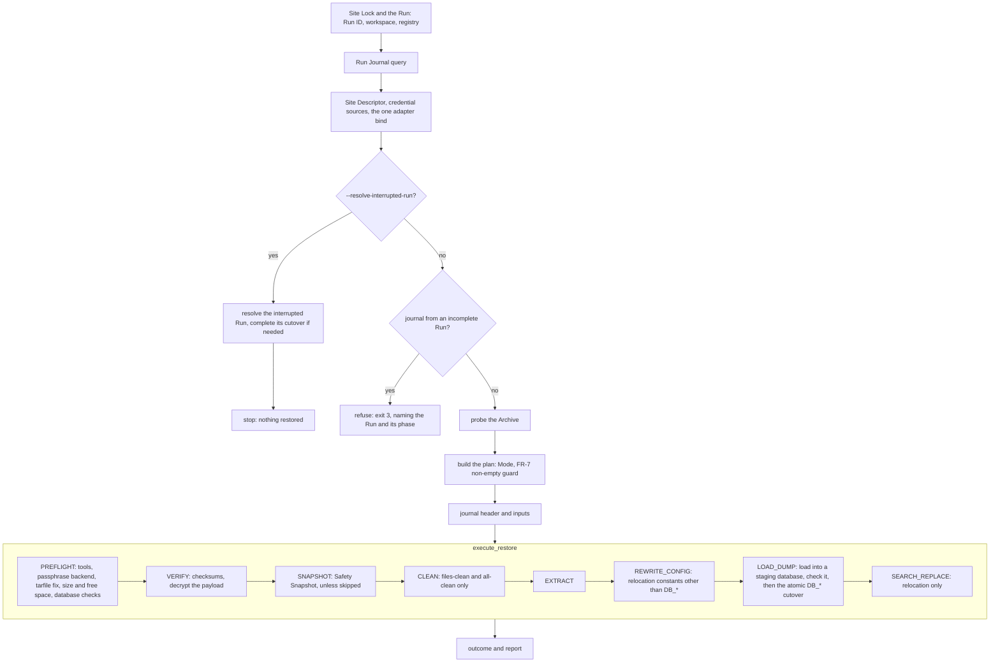

# Restore

How `wpbackup2 restore` puts an Archive back onto a Site, and what it refuses.
Every flag, `--whatIf` included, is listed by `wpbackup2 restore --help`.
`--whatIf` (or `--what-if`) may be given before or after `restore`:
`wpbackup2 --whatIf restore ...` and `wpbackup2 restore --whatIf ...` are the
same Dry Run.

## Terms

The capitalised words below have one meaning throughout this page (UX-9).

- **Site** — one WordPress installation: its files and its database.
- **Site Root** — the directory WordPress is installed in;
  set by `--wp-dir`.
- **Archive** — the file a backup writes and a restore reads (`--archive`).
- **Dump** — the database's SQL contents inside an Archive.
- **Restore Mode** (or Mode) — what a restore puts back and what it may remove:
  files, the database or both (`--mode`, `--cleanfirst`, `--drop-database`;
  see the table below).
- **Run** — one invocation of `wpbackup2`, named by its Run ID (a UUID in
  every log record, `l3io_run_id`).
- **Dry Run** — a Run with `--whatIf`: it checks and prints, and changes nothing.
- **Run workspace** — the Run's private scratch directory (mode `0700`),
  `l3io-wp-backup-*` under `$TMPDIR`, removed when the Run ends; the Archive's
  copy, a decrypted payload and the Dump are held there, never in the Site Root.
- **Safety Snapshot** — the backup a restore takes of what it is about to
  replace, before the first destructive step; written to `--snapshot-dir`, by
  default the per-user state directory (below).
- **Run Journal** — the restore's record of each phase it started and
  completed, so a Run killed part-way is detected and resolved
  (`--resolve-interrupted-run`).
- **Site Lock** — the lock that stops two Runs of the same Site at once
  (exit 9 `LOCKED`).
- **Per-user state directory** — where the Run Journal, the Site Lock and the
  default Safety Snapshots live: `$XDG_STATE_HOME/l3io-wp-backup`, or
  `~/.local/state/l3io-wp-backup` when `XDG_STATE_HOME` is unset (on Linux).
  The journal and snapshots of one Site are under
  `snapshots/<SHA-256 of its resolved Site Root path>/`, the locks under `locks/`.
- **Phase** — one step of a restore, logged in upper case (`PREFLIGHT`,
  `VERIFY`, `SNAPSHOT`, `CLEAN`, `EXTRACT`, `REWRITE_CONFIG`, `LOAD_DUMP`,
  `SEARCH_REPLACE`).

## Restore Modes

The Mode is resolved once from the flags and governs the whole Run. A Mode that
does not name file removal removes no files; one that does not name database
removal drops no database.

| Mode             | Flags                                    | Clears the Site Root | Writes files | Loads the Dump | Drops the losing database |
|------------------|------------------------------------------|----------------------|--------------|----------------|---------------------------|
| `files`          | `--mode files`                           | no                   | yes          | no             | no                        |
| `files-clean`    | `--mode files --cleanfirst`              | yes                  | yes          | no             | no                        |
| `database`       | `--mode db`                              | no                   | no           | yes            | no                        |
| `database-clean` | `--mode db --drop-database`              | no                   | no           | yes            | yes                       |
| `all`            | `--mode all`                             | no                   | yes          | yes            | no                        |
| `all-clean`      | `--mode all --cleanfirst --drop-database` | yes                  | yes          | yes            | yes                       |

`--mode all` is the default, so `--cleanfirst --drop-database` alone selects
`all-clean`. The Mode names are what the log (`restore_mode`), refusals
("Restore Mode files") and the completion line use; the flags are what you
type. A library host passes the Mode and its overrides as values, without this
flag table: see [`api.md`](api.md#restore) before forwarding user input into
`RestoreMode` or `Override`. Note the one spelling difference: the flag value `db` is the Mode
`database`. Adding `--force` to any row keeps its Mode and only waives the
non-empty-target refusal for the parts that Mode restores (see below). Any
other combination (for example `--mode db --cleanfirst`) exits 2 `USAGE` and
names the flags that would work.

The phases always run in this order, skipping the ones a Mode does not need:
preflight, verify, safety snapshot, clean, extract, rewrite config, load the
Dump, search-replace.

A Mode that loads the database refuses (exit 3 `REFUSED`) when the Archive
holds no Dump, naming the Archive and its backup scope; `--mode files` restores
its files.

## The database after a restore: a new name, by design

A restore never loads the Dump over the live database. It loads it into a new
**staging database** on the same server, named
`<live name, first 51 characters>_l3s_<first 8 characters of the Run ID>` (for
example `example_wp_l3s_90e53fd8`), checks that it is a WordPress database, and
only then switches `wp-config.php`'s `DB_NAME` to it (the cutover). This is
what keeps the live site intact if the load or the check fails (ADR-0022).

So after a successful `database`, `database-clean`, `all` or `all-clean`
restore **the site permanently runs on the staging database's name**; nothing
renames it back. The report gives its verdict first, then says so:

```
database restored
database: the site now runs on 'example_wp_l3s_90e53fd8' (was 'example_wp')
```

The previous database is kept by `database` and `all`, and dropped (after its
WordPress user's grants on it are revoked) by `database-clean` and
`all-clean`. Either way, **update anything outside this tool that names the
old database**: cron jobs or scripts that dump it, monitoring, other
applications' grants, and your own backup jobs if they name the database
rather than reading `wp-config.php`. A later restore of the same Site names
its staging database after the database the site runs on at that time, so a
second restore gives a name like `example_wp_l3s_90e53fd8_l3s_1a2b3c4d`; the
live part is cut to 51 characters, so a name never exceeds MySQL's 64.

## Exit codes

| Exit | Name                  | A restore exits with it when                                                                 |
|------|-----------------------|----------------------------------------------------------------------------------------------|
| 0    | `OK`                  | it completed (a Dry Run: its plan completed without a refusal)                              |
| 1    | `FAILED`              | something failed, including a database load the report does not call restored               |
| 2    | `USAGE`               | the flags express no Restore Mode, `--archive` is missing, or `--overwrite-wp-config` is given with a Mode that restores no files |
| 3    | `REFUSED`             | a check refused: a non-empty target, an incomplete earlier Run, an unreadable Site Root, an unconfirmed Archive database, a missing Dump, an encrypted Archive with no passphrase, a snapshot that could not be made, a target whose `DB_*` are read from the environment (database Modes) or are another PHP expression, an `--overwrite-wp-config` whose Archive's file does not define `getenv_docker()` for the target's definitions |
| 4    | `CREDENTIALS`         | a Mode that touches the database has no administrator credentials                           |
| 5    | `UNREACHABLE`         | the database server cannot be reached                                                       |
| 7    | `NOT_READY`           | a tool the plan needs is absent or too old, an optional extra is not installed, the Site Lock's state directory is unusable, or the database's load check, run as the WordPress account, could not run (`LoadReadinessError`, naming that account's credential source) |
| 8    | `VERIFICATION_FAILED` | the Archive is malformed or corrupt, or a passphrase is wrong                                |
| 9    | `LOCKED`              | another Run holds this Site's lock                                                          |

## Non-empty targets

A restore never overwrites something it was not told it may. Before any phase
is planned, each part the Mode restores is checked:

- **files** — the Site Root holds any entry **and looks like no WordPress
  site**: it has none of `wp-config.php`, `wp-includes/` or `wp-content/`
  (owner decision 57). Restoring over a recognisable WordPress site needs no
  flag; the Safety Snapshot covers the overwrite. An empty Site Root needs
  none either;
- **database** — the live database (or the `--new-db-name` database) exists
  with at least one table, view, stored routine or event. The live database is always surveyed by the
  administrator in a Mode that restores the database; "not looked at" is never
  taken as empty.

A non-empty part is refused (exit 3 `REFUSED`) unless a flag waives it. The
message names the Mode as you typed it, every non-empty part with what was
found, and the exact flags that would authorize it, for example:

```
refusing to restore with --mode files (Restore Mode files) over a non-empty
target (files): found '/srv/www' (3 entries, none of wp-config.php,
wp-includes, wp-content); nothing was changed. --mode files --force would
authorize it
```

The database part is unchanged for now: any table needs `--force`. Owner
decision 57's database half (tables, but none carrying the site's prefix, need
`--force`; a WordPress database does not) arrives with the direct load into
the live database.

`--force` waives the parts the Mode restores; `--cleanfirst` and
`--drop-database` choose the clean Modes. Waiving the files never waives the
database. There is no prompt. A Dry Run refuses the same way, with the same
exit code. The log record is `restore_refused` (`reason`, `parts`, `found`,
`detail`, `authorizing`, `restore_mode`); when the guard passes, the Run logs
`target_checked` with what it found and the waivers applied.

A Site Root that exists but cannot be read is refused (exit 3), never read as
empty; a missing one is refused as a usage error (exit 2).

Before a clean Mode empties the Site Root, `CLEAN` refuses (exit 3) a Site Root
that is the filesystem root, your home directory, or a directory holding
neither `wp-config.php` nor `wp-includes/`. This is a guard against a mistyped
`--wp-dir`, not a proof that the directory is a WordPress Site: a parent
directory that happens to hold either marker passes it. The control is the
explicit `--cleanfirst` (and `--force` over a non-empty target); check
`--wp-dir` before giving them (RT-006, ADR-0022 amendment 2026-11-07).

## A target with no `wp-config.php`

The Site Descriptor then comes from the Archive's config member, read into the
Run workspace (mode `0600`). Because an Archive can be forged, the database it
names is used only when you confirm it **or the Archive is encrypted**. An
encrypted Archive is authenticated by its passphrase before its config is
read, so its database is used as it says, logged (`archive_database_trusted`)
and shown as the first line of a Dry Run (owner decision 65). For an
unencrypted Archive, `--archive-database USER@HOST[:PORT]/NAME` must name the
same user, host (case-insensitive), port and database as the Archive's
config, or the restore is refused (exit 3) before any database connection. Name the database from your own records, not from
the Archive. When the flag is absent, the refusal deliberately does not show
the Archive's database, so it cannot be pasted back without checking it
(RT-S02-003). When yours differs, the refusal shows the Archive's user, host,
port and database, never a password, and names which of them differ; treat a
difference you did not expect as a sign the Archive may not be what it claims.
The refusal never echoes what you typed. A user part holding `:` (as in `USER:PASSWORD@…`)
is refused as a usage error (exit 2) without being shown. With a target `wp-config.php` the flag is not
needed and is ignored (logged `archive_database_unused`).

The WordPress database account and its password then also come from the
Archive. If the administrator's survey finds that account already exists, the
restore is refused (exit 3, `ExistingDatabaseUserError`) before anything is
changed, because restoring would reset that account's password to the
Archive's, and it may belong to another application. Pass
`--reset-existing-db-user` when the account belongs to this site. A missing
account is created as before, as `USER@'%'`, so WordPress can reach it from
another host, such as a separate web server or container (RT-S02-004).

## What the Dump can reach

The Dump is loaded into a new staging database as the site's WordPress
database account, with whatever rights that account already holds. A normal
Dump touches only the database it is loaded into, but a tampered one can name
other databases, and the server allows whatever the account is allowed. The
live database of the site being restored is covered by the Safety Snapshot;
**other databases the account can reach are not**. Give each site's account
rights on its own database only, and restore only Archives from a source you
trust, or encrypted ones, whose payload `age` authenticates (ADR-0022
amendment, 2026-11-06).

Such an account (the official `mysql` and `mariadb` images create
`MYSQL_USER` with rights on `MYSQL_DATABASE` only) needs no grant on the
staging database beforehand: the administrator creates it and grants the
account `ALL` on it before the load, so the preflight does not refuse the
privileges that grant will give. A load check that still refuses names the
database and the account it ran as (`DatabaseRefusedError`, its `database`
and `account`), never a password.

## Relocation: a new URL, database host, name or account

A restore can stand a Site up somewhere other than where it was backed up from,
for example staging from a production Archive:

```
wpbackup2 restore --wp-dir /srv/staging --archive site.tar.gz --mode all \
  --new-db-host db.staging:3307 --new-db-name staging_wp \
  --new-db-user staging_wp --new-db-password-file ~/.staging-db-password \
  --new-site-url https://staging.example.com \
  --new-site-home-url https://staging.example.com
```

Each flag is optional; a constant whose flag is absent keeps its value. Which
phase writes which `wp-config.php` constant:

| Constant | Flag | Written by |
|---|---|---|
| `WP_SITEURL` | `--new-site-url` | `REWRITE_CONFIG` |
| `WP_HOME` | `--new-site-home-url` | `REWRITE_CONFIG` |
| `DB_HOST` | `--new-db-host` | the cutover at the end of `LOAD_DUMP` |
| `DB_NAME` | `--new-db-name` | the cutover at the end of `LOAD_DUMP` |
| `DB_USER` | `--new-db-user` | the cutover at the end of `LOAD_DUMP` |
| `DB_PASSWORD` | `--new-db-password` | the cutover at the end of `LOAD_DUMP` |

The four `DB_*` constants are written together, by the journaled cutover, only
after the Dump has loaded and been checked, so the Site never points at a
half-loaded database. `REWRITE_CONFIG` writes only the two URL constants. Each
constant is written by its own atomic write, read back before it replaces the
file: a mismatch fails the Run (exit 1) and leaves `wp-config.php` as it was
before that constant. Constants written earlier in the same phase stay written,
and the journal names them; for `REWRITE_CONFIG` the undo text gives each URL
constant's prior value.

- **`--new-db-host`** is `host` or `host:port` (port 1 to 65535); a socket
  path is not accepted. With `--new-db-name` alone, the Site's own host is used; with
  `--new-db-host` alone, the Dump is loaded into a staging database on the new
  host, as described above.
- **`--new-db-name`** loads the Dump straight into that database, which is
  provisioned when absent; `DB_NAME` ends as that name, not a staging name.
- **`--new-db-user` and `--new-db-password`** go together: one without the
  other exits 2 `USAGE`, since keeping half from the Archive would mix two
  accounts. The account is provisioned with rights on the load database, and
  **the Dump is loaded as that account**, with whatever rights it holds (see
  "What the Dump can reach"). Give the password with
  `--new-db-password-file PATH` (its first line; make the file readable only
  by you) or the `L3IO_WP_BACKUP_NEW_DB_PASSWORD` variable (read only with
  `--new-db-user`) rather than `--new-db-password`, whose value is visible in
  the process list and which logs WARNING `password_on_command_line`. The
  first given wins: the flag, then the file, then the variable. The password
  is redacted from every log record and message and is never journaled; one
  shorter than 4 characters, too short to redact, is accepted with WARNING
  `credential_below_redaction_floor` (owner decision 61).
- **`--new-site-url` and `--new-site-home-url`** must start with `http://` or
  `https://`, name a host, hold no whitespace, control character, quote or
  backslash, and not end with `/` (WordPress stores them without one). Anything
  else exits 2 `USAGE` naming the flag and the rule. They set the two
  constants, and the old URL is then rewritten inside the database's content
  (below).

**Modes.** Every `--new-*` flag needs a Mode that restores the database
(`database`, `database-clean`, `all`, `all-clean`). With `files` or
`files-clean` any of them exits 2 `USAGE` before anything is changed: such a
Mode has no cutover, so the value would be accepted and silently discarded.

**A non-empty load database** (the `--new-db-name` database, or the Site's name
on the `--new-db-host` server) is refused like any non-empty target: exit 3
`REFUSED`, before anything is changed. `--force` waives that check, but the
load itself still never loads over a database that holds tables: the database
checks at `PREFLIGHT` refuse it (exit 3), still before anything is changed.
Only when the Site's account cannot see that database does the refusal come
later, at `LOAD_DUMP`, after the Safety Snapshot, journaled.

The Run logs `relocation_planned` once, with the constants each phase writes,
the relocated host, port and database name, and whether each URL changes; never
a URL value or the password. A Dry Run prints the same plan, naming the keys.

### Content URLs: WP-CLI `search-replace`

With `--new-site-url` or `--new-site-home-url`, the last phase,
`SEARCH_REPLACE`, rewrites the old URL across the restored database's content,
so widgets, menus and theme options keep working. It runs after
`REWRITE_CONFIG` and after `LOAD_DUMP`'s cutover, because WP-CLI bootstraps
from the `wp-config.php` just written. It needs WP-CLI (`wp`) on `PATH`.

`PREFLIGHT` checks that `wp` is at least 2.12.0, and the printed plan's
preflight line names it (`wp >= 2.12.0`). Before any effect the restore also
prepares the owner-only state directory `wp` will run from and refuses (exit 3)
if a `wp-cli.yml` sits in it or above it.

- **What is replaced.** The old values are the restored database's stored
  `siteurl` and `home` options, read with `wp option list` (not `option get`,
  which would return the constants just written). Each is replaced by its new
  URL; when the two stored values are equal, one replacement is made, to the
  home URL if given (with only one of the two flags, that one replacement
  moves both, and the Run logs WARNING `search_replace_home_moved`). A stored
  value is the Archive's own text, so it must pass the same string rules as a
  `--new-site-url` (an `http://` or `https://` URL, no leading `-`, no
  whitespace, control character or quote; a trailing `/` is allowed): one that
  does not exits 3 `REFUSED` before anything is replaced, without printing it.
- **Order, and when it is refused.** The replacements run one after another,
  longer old URLs first. If one replacement's old URL occurs inside the other's
  new URL (for example `https://example.com/wp` and `https://example.com`
  moved to `https://example.com.au/wp` and `https://example.com.au`), the
  second pass would rewrite the first one's result. The order is changed when
  that avoids it; when no order does, the Run is refused (exit 3) before
  anything is replaced. Rewrite such pairs yourself with `wp search-replace`,
  through a temporary placeholder string.
- **How.** `wp search-replace <old> <new> --precise --all-tables-with-prefix
  --skip-columns=guid --report-changed-only`: every table with the Site's table
  prefix, plugin tables included. WP-CLI unserializes PHP-serialized values,
  replaces inside them and re-serializes them with corrected lengths; this tool
  never edits a serialized value or runs an SQL `REPLACE`. `guid` columns are
  left alone, as WordPress requires. Each replacement is previewed with
  `--dry-run` first, and re-counted afterwards: any old URL left fails the Run
  (exit 1). A replacement whose new URL contains its old URL (a move into a
  subdirectory of the same host) cannot be re-counted that way; it is skipped,
  with WARNING `post_check_skipped`.
- **What is not replaced.** Only the stored value, verbatim. JSON-escaped
  (`https:\/\/old…`), URL-encoded and protocol-relative (`//old…`) forms, a
  bare host name and the other scheme are left as they are; run
  `wp search-replace` for those yourself if the Site holds them.
- **Reported.** The restore report prints
  `content URLs: <n> replacements in <k> tables (<old> → <new>)`, and the JSON
  report's `search_replace` holds `replacements`, `tables`, `pairs`,
  `remaining` and `merged`. The Run logs `search_replace_completed` with the
  same and the WP-CLI version. A Dry Run prints the planned pairs (the old URL
  is read only after the Dump is loaded, so it shows as `<unresolved>`) and
  says the counts are determined after `LOAD_DUMP`; it changes nothing.
- **Interrupted or failed.** A failure after the first replacement leaves
  earlier ones made. The journal names `SEARCH_REPLACE` and the `wp
  search-replace` commands still owed. Check each first with `--dry-run`
  added, and re-run only those that still find their old URL. Never re-run
  one whose new URL contains its own old URL or the other command's old URL:
  it would rewrite its own results. When the stored `siteurl` and `home` were
  equal, only one of the two listed commands is owed.

**What runs inside WP-CLI.** WP-CLI loads WordPress to reach the database, so
code from the restored Site runs: `wp-config.php` itself, the mu-plugins in
`wp-content/mu-plugins` (WP-CLI loads them even with `--skip-plugins`), and
drop-ins such as `wp-content/db.php`. Regular plugins and themes do not run
(`--skip-plugins --skip-themes`), nor do globally installed WP-CLI packages
(`--skip-packages`).

- **No WP-CLI config is read.** `wp` runs from a fresh owner-only directory
  under this tool's per-user state directory, never from the Site Root or
  `$TMPDIR`. WP-CLI reads `wp-cli.yml` and `wp-cli.local.yml` from its working
  directory and every directory above it, and such a file can load PHP; if one
  is found there, the Run is refused (exit 3) before `wp` runs.
  `WP_CLI_CONFIG_PATH` names an empty file, so no `~/.wp-cli/config.yml` is
  read either. The `wp cli version` probe that preflight runs starts from the
  filesystem root, not from the Run workspace under the shared `$TMPDIR`, where
  another user could plant a `wp-cli.yml`; a `wp-cli.yml` there (the path as
  given and resolved) refuses the Run (exit 3) before the probe runs, and
  the probe also gets `--skip-plugins --skip-themes --skip-packages
  --no-color`.
- **The environment it gets.** Exactly `PATH`, `HOME`, `LC_ALL=C` and
  `WP_CLI_CONFIG_PATH`. Nothing else is passed on: not the Archive passphrase
  (`L3IO_WP_BACKUP_PASSPHRASE`), not any other `L3IO_WP_BACKUP_*`, `MYSQL_*` or
  `WP_CLI_*` variable. WP-CLI reads the database password from
  `wp-config.php`; none is passed by argument or environment. The same holds
  for the version probes run before anything is changed. This keeps the
  variables from being *inherited*; it does not hide them from the restored
  code, which runs as your user and could read this process's own
  `/proc/<pid>/environ` and `/proc/<pid>/cmdline`. On Linux, the process
  therefore marks itself non-dumpable (`prctl(PR_SET_DUMPABLE, 0)`) while a
  `wp` child runs, which makes its `environ` unreadable to that child; as
  root, and on other systems, this does nothing, and `cmdline` (which holds
  `--admin-password` and `--new-db-password` when you pass them) stays world
  readable. Child processes
  started by the database library (the database client tools and `age`)
  still inherit this tool's environment; they run no Site code.
- **A time limit.** A `wp` call is killed after four hours and the Run fails
  (exit 1) with the step named, so restored code that never returns does not
  hold the Site Lock for ever. Its output is capped at 8 MiB on each of
  stdout and stderr; past that its whole process group is killed and the Run
  fails (exit 1).
- **Not as root.** A restore started as root runs as the Site Root's owner
  (below), so `wp` does too. A library caller running as root is refused; if
  WP-CLI is somehow reached as root, it is given `--allow-root` and the Run
  logs WARNING `wp_cli_running_as_root`.

**It is not confined (accepted for v1, owner decision 2026-11-07,
BL-E008-014).** The restored Site's `wp-config.php`, mu-plugins and drop-ins
run in the `wp` child **as the OS user running the restore**, with that user's
real `HOME` and every file it can read or write; no sandbox, namespace or
seccomp filter is applied. The limits above (environment, working directory,
time, output) narrow what the child inherits, not what it may do. Only a URL
relocation (`--new-site-url`, `--new-site-home-url`) runs `wp`; a restore
without one runs no Site code. What makes the code trustworthy is the Archive:
an **encrypted** Archive is authenticated by `age` before anything is changed,
so the code that runs is the code that was backed up with your passphrase. An
**unencrypted** Archive is not authenticated, and whoever could write it could
have put PHP in it. Such a restore logs the WARNING `archive_unauthenticated`
(and, under `--log-format console`, prints it) before any effect, URL
relocation included; restore an unencrypted Archive with a relocation only
from a source you trust, or pass `--require-encrypted`. Optional confinement of
the `wp` child is planned after v1.

## TLS to the database

By default no TLS is required, for backup or restore, the WordPress account
or the administrator: the tool connects the way WordPress does (owner
decision 56, amending BL-E002-114's verified-TLS policy). `--db-tls
{required,verify-ca,verify-identity}` (also `L3IO_WP_BACKUP_DB_TLS`, config
key `db_tls`) requires it on every connection of the Run, local hosts
included; `--db-tls-ca FILE` names the CA bundle for a private CA, with
`verify-ca` or `verify-identity` (alone, or with `required`, it exits 2
`USAGE` before any connection). A server that cannot complete the required
handshake exits 5 `UNREACHABLE`; one whose certificate does not verify exits
3 `REFUSED`. `--admin-tls` and `--admin-tls-ca` are deprecated spellings of
the two, logged as WARNING `deprecated_option`.

On every connection, a server that asks for an authentication plugin that
would expose the password (`mysql_clear_password`, `mysql_old_password` or
`dialog`) is refused before any password is sent: exit 3 `REFUSED`, naming
the plugin and the server (RT-S02-003; `l3io-wordpress-database` 0.3.2).

## Interrupted Runs

The Run Journal and the Site Lock live in the per-user state directory of the
OS user running the restore. A restore of the same Site by another OS user
neither sees that journal nor waits for that lock, so run every restore of a
Site as the same user.

The lock is keyed by the Site Root's resolved path (symlinks followed), as
spelled. Two spellings of one directory that resolve differently are two locks
(an accepted limit, BL-E002-083): on a case-insensitive filesystem (macOS by
default) `/srv/Site` and `/srv/site`, and on Linux a bind mount of the Site
Root at a second path. Always name a Site by the same path.

A Run killed part-way leaves its journal open. The next restore of the Site is
refused (exit 3), naming the interrupted Run, its phase, how to undo it and the
journal's path. `--resolve-interrupted-run RUN_ID` acknowledges it (completing
an interrupted `wp-config.php` cutover first) and stops: resolving and
restoring are never one command. A different ID is refused, naming the
journal's. `--archive` is still required alongside it, even though resolving
reads nothing from the Archive when `wp-config.php` is present.

Before completing a cutover, resolution surveys the database the interrupted
Run was switching to. If it no longer exists or is not a WordPress database,
nothing is written and the resolution is refused (exit 3 `REFUSED`), naming
it: set the keys already written back to the values the journal records, or
restore from the Safety Snapshot, then resolve again. When `wp-config.php`
already holds its pre-Run values (no key landed, or you set them back), there
is nothing to complete: resolution writes nothing, logs the WARNING
`cutover_abandoned`, and acknowledges the Run.

A journal that cannot be read back (`CorruptJournalError`, exit 3) names no
Run to resolve, so `--resolve-interrupted-run` cannot clear it. Inspect the
Site and the journal file the refusal names, repair the Site if needed, then
move that file aside (for example rename it with a `.corrupt` suffix) before
restoring again.

## How a Run is driven

`drive_restore` (in `cli/restore.py`) is the one driver both the CLI and the
library call. Everything before the executor only reads; the executor
(`execute_restore`, in `adapters/restore_runner.py`) runs the plan's phases in
order, and the live database changes only at the `wp-config.php` cutover that
ends `LOAD_DUMP`.



Every phase is journaled before it starts and after it completes. Only the
phases the plan holds run: a `files` Mode has no `LOAD_DUMP`, a `database`
Mode no `EXTRACT`, and `--no-safety-snapshot` removes `SNAPSHOT`.

## Before anything is changed

Every check below runs before the first destructive step, so a refusal leaves
the Site, the database and every Storage Target as they were.

The Archive is first copied into the Run workspace (mode `0600`), and every
later read — verification, extraction, the config member — reads that copy, so
a file replaced at the Storage Target after verification is never restored.

**Trust.** Verification of an unencrypted Archive proves its checksums are
consistent with its Manifest, not that it is authentic: whoever can write the
Archive can rewrite both. The restore proceeds: before it changes anything it
logs the WARNING `archive_unauthenticated` and writes a warning to stderr,
which names an Archive with no checksums at all (a v0 Archive,
`STRUCTURAL_ONLY`) as such. Restore only Archives from a source
you trust, or encrypted ones, whose payload `age` authenticates.

**What authentication proves, and what it does not.** For an encrypted
Archive, `wpbackup2 verify --authenticate` and the restore's `VERIFY` decrypt
the whole payload with the passphrase; `age` authenticates every chunk. The
payload ends with an inner copy of the Manifest, and both then require it to
match the unencrypted `manifest.json` field by field, less the payload's own
size and checksum. A Manifest edited outside the payload (its scope, source or
member list), or a payload swapped in from another Archive, is refused with
`PayloadDamagedError` (exit 8), naming the first field that differs, before the
Safety Snapshot and before anything destructive. **A rollback is not
detected:** a whole older Archive encrypted with the same passphrase, put in
place of a newer one, is genuine, so it passes. Detecting that needs a record
kept outside the Archive, such as the name or checksum of the latest backup,
which this package does not keep.

**Encryption protects file contents only.** `manifest.json` is never
encrypted: the Site Root path, the database name, every file path and size and
the exclusions stay readable in clear in an encrypted Archive, to anyone who
can read it, without the passphrase.

**Downgrade by substitution: `--require-encrypted`.** Authentication binds only
Archives that are encrypted. Someone who can write the Storage Target can
replace an encrypted Archive with a forged plain one, and a restore that
finds no encryption does not know one was expected. By default it restores the
plain Archive with the warning above (plain Archives are not authenticated,
ADR-0016 amendment). That holds when a passphrase was given too: the restore
proceeds, with WARNING `archive_not_encrypted` on stderr, since a passphrase
meant an encrypted Archive was expected (owner decision 59, reversing the
2026-11-07 refusal; `--allow-unencrypted` is deprecated and does nothing).
`restore --require-encrypted` refuses any Archive that is
not encrypted, before anything changes, with `ArchiveNotEncryptedError` (a usage
error, exit 2, the same refusal `verify --authenticate` gives a plain Archive).
Use it in cron and disaster-recovery runs that only ever restore encrypted
Archives.

**Quiesce the Site first.** A restore does not stop the web server, put the
Site into maintenance or lock its database. Whatever is written to the Site
Root or the live database after the Safety Snapshot is taken and before the
restore finishes is in neither the snapshot nor the Archive, and `CLEAN` or a
Mode that drops the live database removes it. The re-survey before the first
destructive step refuses only a part that went from empty to holding content,
not a change to a part that was already non-empty (an accepted limit,
BL-E003-113: nothing short of stopping the Site's writers can detect it). Take
the Site offline (or stop its writers) before running `restore`.

1. **Preflight** — the required tools, the passphrase backend when the Archive
   is encrypted, the interpreter's tarfile fixes, free space, and (for a Mode
   that loads the Dump) the database checks.
2. **Verify** — the Archive is verified. A corrupt Archive exits
   `VERIFICATION_FAILED` (8). An encrypted Archive's payload is then decrypted
   into the Run workspace; a wrong passphrase or a damaged payload also exits
   `VERIFICATION_FAILED`. A v0 Archive (no Manifest) is reported as
   `STRUCTURAL_ONLY`, never as `VERIFIED`. A v0 Archive holding a hard link
   (0.2.21 wrote one for any Site file with more than one link) fails
   verification with `UNSUPPORTED_MEMBER_TYPE` and cannot be restored; take a
   fresh backup of that Site with this version instead. An Archive that changed
   between planning and verification is refused with the same exit code.

### Interpreter

Extraction relies on Python's `tarfile` `data` filter, which could be escaped
before the June 2025 security fixes (CVE-2025-4517, CVE-2025-4330,
CVE-2025-4138, CVE-2024-12718). On a Python without them (before 3.11.13,
3.12.11 or 3.13.4) every restore is refused in preflight, before `files-clean`
or `all-clean` deletes anything. Upgrade Python to a patched release.

### Size and free-space limits

Two limits, each changed only by a recorded decision:

- **Free space margin: 5%.** The files a restore writes onto the target (the
  Site Root files, and a laid-down `wp-config.php`) must fit in the target
  filesystem's free space less 5%. What the Run workspace holds — the decrypted
  payload, the Dump and the copy of the Archive's `wp-config.php` — must fit in
  the workspace filesystem's free space less 5%. The Dump never lands on the
  target.
- **Expansion ratio: 200.** An Archive whose members expand to more than 200
  times its compressed size is refused as a decompression bomb.

Both refusals exit `REFUSED` and change nothing. A space refusal names the
filesystem that is short and the paths on it, the space needed, free and
short (in MiB, with the exact bytes), and the remedy: free that much, or use a
location on another filesystem (the Run workspace follows `TMPDIR`, the Safety
Snapshot `--snapshot-dir`). The expansion limit has no override. For a v1 Archive the sizes come from its Manifest;
for a v0 Archive they are read from its tar headers. During extraction a member
whose header states more bytes than its Manifest entry is refused. Every
refusal at a member says the Archive may be damaged or tampered with and to
check it with `wpbackup2 verify --archive <archive>`.

**These two checks are advisory.** They run in preflight, before the Archive
is verified, so they trust the sizes its index states (ADV-12, SD-01-4). A
forged index can understate its sizes and pass them; a corrupt Archive can be
refused here (exit 3) before verification would have called it corrupt (exit
8). Verification and extraction are the enforcement: verification checks every
member against the Manifest, and extraction holds each member to its indexed
size with a running total, so an Archive never writes more than its index
declares.

When the Run takes a Safety Snapshot of the files, the Site Root's current file
bytes are charged to the snapshot directory's filesystem. Destinations on the
same filesystem (the target, the workspace and the snapshot directory) are
summed against its one free space.

Not checked in advance (accepted limits, owner decision 2026-11-07):

- **The database part of a Safety Snapshot** is charged 0 bytes: its Dump size
  is not known before the dump, and no live-database size is queried
  (BL-E003-048). A snapshot that runs out of space fails while it is written,
  before anything is destroyed, and the restore stops with `REFUSED`.
- **The database server's disk** is not checked at all (BL-E003-116). The Dump
  is loaded into a staging database on the server, beside the live one until
  the cutover, so the server needs room for a second copy of the Site's
  database; this tool cannot see that disk. A load that fills it fails in
  `LOAD_DUMP` before the cutover, and the live database is left as it was.
  Check the server's free space first for a large Site.

**Memory when reading an Archive (owner decision 2026-11-07, BL-E008-011).** The
Manifest is read whole and parsed before anything is authenticated, taking
about 4.3 times its size in memory. The Manifest cap is 256 MiB, so the worst
case is about 1.1 GB; an ordinary Site's Manifest is a few MB. `verify` reads
it the same way. A streaming parse, then an on-disk member index for truly
bounded memory, are planned after v1.

## Safety Snapshot

Before the first destructive phase the Run writes a Safety Snapshot: an
Archive of every part the Mode may destroy that is not empty (`files`,
`database` or both), written by the backup path inside the restore's own Run
(one Run ID, one Site Lock). It is verified again after it is published; a
snapshot that cannot be written and verified stops the restore with
`REFUSED` before anything is destroyed, and a written-but-unverified file is
left in place. Its log record is `safety_snapshot_written`, with its path.

`--no-safety-snapshot` skips it and logs the WARNING `safety_snapshot_skipped`.
When every part the Mode touches is empty, no snapshot is taken and the Run
logs `safety_snapshot_not_needed`. `--snapshot-dir` is refused inside the Site
Root or the `wp-config.php` directory; a directory a web server serves from
elsewhere is not detected. In a Dry Run nothing is written and the snapshot is
reported as "would verify".

Immediately before the first destructive phase the target is surveyed again.
If a part that was empty at planning now holds content the snapshot does not
cover, or the non-empty guard now refuses, the restore stops with `REFUSED`
before anything is destroyed. That Run's journal stays open (nothing was
changed), so the next restore names it until it is resolved.

The passphrase comes from `L3IO_WP_BACKUP_PASSPHRASE` or, on a terminal, a
prompt that runs before the Archive is read. The one passphrase decrypts an
encrypted Archive and encrypts the snapshot, so the prompt asks for it on every
interactive restore and says both uses; leave it empty for none. With a
passphrase, stderr says `safety snapshot is encrypted with the passphrase this
restore was given: <path>`, and restoring that snapshot needs it. Without one
the snapshot is written unencrypted and the Run says so on stderr (`safety
snapshot is NOT encrypted: <path>`). When a later phase fails, the snapshot's
path is printed with the failure.

A restore takes a passphrase of any length, so an Archive encrypted before the
12-character floor existed stays restorable; one shorter than 12 logs WARNING
`passphrase_below_encryption_floor` (it also encrypts the snapshot), and one
shorter than 4 also logs WARNING `credential_below_redaction_floor`, naming
where it came from, never the value: it is too short to be masked in logs
(owner decision 69). `verify --authenticate` accepts it the same way.

The published snapshot file is mode `0600`, and every directory the Run
creates for it is `0700` (an existing directory is left as it is); a published
file readable by anyone else stops the Run with `REFUSED` before anything is
destroyed. An unencrypted
snapshot holds the Site's `wp-config.php` (with its database password) and a
Dump of its database. **Nothing removes snapshots, or the `wp-config.php`
copies `--overwrite-wp-config` saves beside them:** each stays in its directory
until you delete it, so delete those you no longer need (accepted for v1,
BL-E003-087; a snapshot `prune` command is planned after v1).

**A `--snapshot-dir` below a one-level-up config's directory is refused.** When
the Site keeps its `wp-config.php` one level up (`~/public_html` with
`~/wp-config.php`), every directory below that config's directory counts as
possibly web-served, so a snapshot directory anywhere under `~` is refused,
even one no web server serves (BL-E003-033, accepted). The default, the
per-user state directory, is also under `~` in that layout; pass
`--snapshot-dir` naming a directory outside it, such as one under `/var/backups`.

## `wp-config.php`

By default the target's `wp-config.php` is **kept**: the Archive's copy is
never extracted over it, `--cleanfirst` does not remove it, and only the
database cutover changes it. The Run logs `wp_config_kept`. When the target has
no `wp-config.php`, the Archive's copy arrives with the files.

`--overwrite-wp-config` (file Modes only; with `--mode db` it exits 2
`USAGE`) replaces the target's file with the
Archive's, keeping the target's own `DB_HOST`, `DB_USER`, `DB_PASSWORD` and
`DB_NAME`, so the Site never points at the source's database. Each of the four
is carried into the Archive's file **as the target wrote it**, not as a value:
`define( 'DB_HOST', getenv_docker('WORDPRESS_DB_HOST', 'mysql') );` stays a
lookup that follows the container's environment, and a literal stays that
literal (owner decision 48). A literal lands exactly as before unless the
target spelled it differently from `'value'` (double quotes, say): the
target's spelling is kept, with the same PHP value. A copy of the
original is saved first (mode `0600`) beside the Run Journal, and the Run logs
the WARNING `wp_config_overwritten`. An Archive without a `wp-config.php` is
refused with this flag (exit 3; omit it to keep the target's), as is one whose
`wp-config.php` is larger than 1 MiB, before anything is changed. The
Archive's copy is read into memory and written only once, over the target's
file; no other copy of it is written, and a Dry Run writes none.

**The Archive's file is applied whole, code included.** Apart from the four
`DB_*` constants, nothing in the Archive's `wp-config.php` is filtered or
inspected: any PHP it holds beyond its settings (an `include`, a function
call, an edit an attacker made) runs on the target, exactly like the plugins,
themes and core files the same Archive restores. The Run gives no separate
warning about it. Restore only Archives you trust, and keep the default
(the target's `wp-config.php`) when you are unsure of the Archive's copy.

**A target whose `DB_*` are read from the environment.** The official
WordPress Docker image defines its settings as, for example,
`define( 'DB_NAME', getenv_docker('WORDPRESS_DB_NAME', 'wordpress') );`.
A Mode that restores the database would turn such a definition into a fixed
string (its cutover rewrites `DB_NAME` to the staging database's name), and
the site would stop following its environment, so it is **refused** before
anything is changed, a Dry Run included, with exit 3 `REFUSED`
(`EnvironmentDrivenTargetError`, naming the constants and the variables they
read, never a value). The same applies when the target has no
`wp-config.php` and the Archive's copy reads its `DB_*` from the environment.
A files-only restore is not refused: it resolves the settings from the
restore's own environment, as a backup does.

With `--overwrite-wp-config`, a files-only restore carries those definitions
into the Archive's file as written (above). `getenv_docker()` is not a PHP
function: the image's `wp-config.php` defines it. So when the target reads
any of its `DB_*` through `getenv_docker()`, the Archive's file must define
it before those definitions, or PHP would stop every request with "Call to
undefined function getenv_docker()". An Archive's file that does not is
**refused** before anything is changed, a Dry Run included, with exit 3
`REFUSED` (`UndefinedConfigFunctionError`, naming the constants); keep the
target's `wp-config.php` (omit `--overwrite-wp-config`), or restore from an
Archive taken from a Docker site. `getenv('NAME')` needs nothing: PHP defines
it.

That check is `l3io-wordpress-config`'s own (`declares_function`, 0.1.7): a
lexical search of the Archive's file, outside comments and strings, for
`function getenv_docker(` or `function &getenv_docker(` (in any case) before
the first carried definition. Its limits are the library's, as it documents
them:

- **It can accept a file PHP would still reject:** a declaration in a branch
  PHP never runs, inside a class (a method), nested in another function, or
  inside a heredoc string, still counts. The restored site then fails with
  that error; the saved copy of the original (above) is the way back.
- **It can refuse a file PHP would run:** the function defined in a file the
  config includes (`include`/`require` is not followed), or declared after
  its use (the check is text order; PHP hoists a top-level function). Keep
  the target's file then.

How a database restore should switch such a site to the restored data, by
loading into the database name the environment names rather than by rewriting
`wp-config.php`, is the subject of
[ADR-0027](adr/0027-restore-into-an-environment-driven-database.md), which is
**Proposed** and not implemented (owner decision 47). Until then, restore the
database of such a site by defining its `DB_*` as literals first (for example
with `wp config set DB_NAME <name>`), or with your database tools.

Any other PHP expression in `DB_HOST`, `DB_NAME`, `DB_USER`, `DB_PASSWORD` or
`$table_prefix` (anything but a literal, `getenv_docker('NAME', <literal>)` or
`getenv('NAME')`) is refused, exit 3 `REFUSED` (`UnsupportedConfigValueError`),
by every command that reads it: this tool does not evaluate PHP.

### Where the config is, and where it is laid down

WordPress reads `<Site Root>/wp-config.php`, else `<Site Root>/../wp-config.php`
when the parent directory holds no `wp-settings.php` (a parent that holds one
is another WordPress install). A restore finds the target's config the same
way, or uses `--wp-config PATH` as given. The INFO record `config_located`
names the file, its location (`wp-config.php` or `../wp-config.php`), and
whether it was found on the target, recorded in the Manifest or defaulted.

A Site that keeps its config one level up is backed up with that file as the
Archive member `config/wp-config.php` (never a `../` path), and the Manifest
records `config_path: "../wp-config.php"`. When the target has **no** config,
a Mode that restores files lays the Archive's copy down where the Manifest
says, before any constant is rewritten: restoring into `<dir>/public` writes
`<dir>/wp-config.php` and nothing at `<dir>/public/wp-config.php`. The journal
names that file, so `--resolve-interrupted-run` completes an interrupted
cutover in it. A Dry Run prints `lay down <path>` and writes nothing.

A target config WordPress reads is otherwise used as it is. Refused before
anything is changed (exit 3):

- a Manifest `config_path` other than those two values, with or without
  `--wp-config`; it is never used as a path;
- when the Manifest records `../wp-config.php` and the target has no config
  WordPress reads: a parent directory that holds `wp-settings.php`;
- when the Manifest records `../wp-config.php`: a parent `wp-config.php` next
  to an existing `<Site Root>/wp-config.php` (WordPress reads the Site Root's,
  so remove the one you do not mean);
- anything that is not a regular file (a directory, a dangling symlink) where
  the config would be laid down.

A database-only Mode never lays a config down; with no target config it is
refused as described under [A target with no `wp-config.php`](#a-target-with-no-wp-configphp).
An Archive that records no location (a v0 Archive, or a v1 one made with a
`--wp-config` outside both places) has its `wp-config.php` laid down at the
default, `<Site Root>/wp-config.php`, by a Mode that restores files. With a URL relocation, a `--wp-config` that is not the file
WordPress loads for the Site (the Site Root's when both exist) is refused as a
usage error (exit 2), since WP-CLI would rewrite URLs from another config.

The Site Lock covers the Site Root, not its parent: a `wp-config.php` created
one level up after the checks and before the lay-down is not detected, and the
lay-down overwrites it; it is in neither the pre-restore checks nor the Safety
Snapshot.

The laid-down file's mode is logged (INFO `config_laid_down`). It holds
`DB_PASSWORD`, so every "other" permission bit is taken off it straight after
it is written, whatever the Archive's mode was, with WARNING
`config_mode_restricted` (path, the Archive's mode and the new mode) when that
changed anything. Owner and group bits are kept (`0644` becomes `0640`, not
`0600`: PHP often reads the file through a shared group; owner decision 43).
When the config is laid down
by itself, the Archive's own `wp-config.php` in the Site Root tree is not
extracted, so it cannot shadow the one WordPress is meant to read.

## Symlinks

A symlink whose target is absolute or resolves outside the Site Root is **not
supported**. It is skipped on restore with a WARNING (`symlink_skipped`), and
the Run still exits `OK`. A Dry Run lists those links after its actions; for a
v0 Archive, which records no link targets, they are reported at extraction.

The Dry Run decides from the Archive alone, by the link's own text: a target
that starts with `/`, or that leaves the Site Root once joined to the link's
directory. Extraction decides on disk, following symlinks that already exist
on the target. The two agree for every link the Archive itself defines; they
can differ when a directory on the target is already a symlink (for example
`wp-content/uploads` pointing at `/mnt/media` in a `files` restore, which does
not clear the Site Root). Then the real Run may skip or refuse members the Dry
Run did not list. The real Run's WARNINGs are the authority.

## Dry Run

`wpbackup2 restore --whatIf ...` (or `wpbackup2 --whatIf restore ...`) prints
the ordered actions the real Run would take and runs every check the real Run
runs, so it refuses where the real Run would, with the same exit code. It
changes nothing: not the Site, the database, any Storage Target, the snapshot
directory or the journal directory. Only the Run workspace is written (an
encrypted payload is decrypted there to check the passphrase), and the Site
Lock is taken as for a real Run: its lock file is created under the per-user
state directory, and a Dry Run is refused with `LOCKED` (exit 9) while
another Run of the same Site holds it.

## What a Run prints

Results go to stdout; warnings and the log go to stderr.

With the default (console) log format, stdout carries the Dry Run's ordered
actions, then the links it would skip (`would skip symlink '<path>' ->
'<target>': <reason> (not supported)`, or for a v0 Archive one line saying they
are reported at extraction), the database report, the search-replace count, the Safety Snapshot's
path and whether `wp-config.php` was kept, each when there is one, and ends
with one completion line naming the Mode, the Archive and the Site:
`restore complete (...)`, or for a Dry Run `Dry Run complete (...); nothing was
changed`. A Run that fails prints no completion line; if it had already taken
a Safety Snapshot it prints `safety snapshot: <path>`.

With `--log-format json`, stdout is exactly one JSON object and nothing else:

```
{"restore": {"status": "completed", "run_id": "...", "dry_run": false,
 "restore_mode": "files", "archive": "...", "site_root": "...",
 "resolved_run_id": null, "actions": [], "skipped_links": [],
 "database_report": null, "search_replace": null, "snapshot_path": null,
 "snapshot_encrypted": false, "wp_config_kept": true}}
```

(shown wrapped; it is one line). `status` is `completed`, `planned` (a Dry
Run, whose `actions` list the plan), `resolved` or `would_resolve`
(`--resolve-interrupted-run`), or `failed` (the database report does not call
the database restored). `skipped_links` lists each link extraction skipped
(`path`, `link_target` and `reason`: `absolute` or `outside_destination`); in a
Dry Run, the links the real Run would skip, and `null` for a v0 Archive, whose
links are reported only at extraction. `database_report` holds the same fields as the
`database_restore_report` log record. A Run that fails after its Safety
Snapshot prints `{"restore": {"status": "failed", "error": "<class>",
"snapshot_path": "<path>"}}`.

## Worked examples

Real output of a files-only Site, with the log on stderr at WARNING
(`--log-level WARNING`). The temporary directory prefix is replaced by
`/srv/www/example` and `/backups`, the state directory by `<state>`, and long
log records are cut.

A refusal: the Site Root is not empty and `--force` was not given.

```
$ wpbackup2 restore --wp-dir /srv/www/example --archive /backups/example.tar.gz --mode files
WARNING: the archive is not encrypted, so it cannot be authenticated; restore only an archive from a source you trust
wpbackup2: error: refusing to restore with --mode files (Restore Mode files) over a non-empty target (files): found '/srv/www/example' (4 entries); nothing was changed. --mode files --force would authorize it [exit 3 REFUSED: a check found a reason not to act; nothing was done]
$ echo $?
3
```

A Dry Run of the authorized command:

```
$ wpbackup2 restore --whatIf --wp-dir /srv/www/example --archive /backups/example.tar.gz --mode files --force
WARNING: the archive is not encrypted, so it cannot be authenticated; restore only an archive from a source you trust
preflight: required tools, the interpreter's tarfile fixes, free space
verify /backups/example.tar.gz
safety snapshot of files to <state>/l3io-wp-backup/snapshots/3174eaae...
extract the Archive's files into /srv/www/example
safety snapshot: <state>/l3io-wp-backup/snapshots/3174eaae.../20261106T093634Z-89abe821-....tar.gz
wp-config.php kept (target's); pass --overwrite-wp-config to replace it
Dry Run complete (Restore Mode files, archive /backups/example.tar.gz, site /srv/www/example); nothing was changed
```

The real Run:

```
$ wpbackup2 restore --wp-dir /srv/www/example --archive /backups/example.tar.gz --mode files --force
WARNING: the archive is not encrypted, so it cannot be authenticated; restore only an archive from a source you trust
safety snapshot is NOT encrypted: <state>/l3io-wp-backup/snapshots/3174eaae.../20261106T093634Z-90e53fd8-....tar.gz
safety snapshot: <state>/l3io-wp-backup/snapshots/3174eaae.../20261106T093634Z-90e53fd8-....tar.gz
wp-config.php kept (target's); pass --overwrite-wp-config to replace it
restore complete (Restore Mode files, archive /backups/example.tar.gz, site /srv/www/example)
```

A Mode that loads the database adds the database report before the Safety
Snapshot line: the database the site now runs on and the one it ran on, what
was created, the bytes loaded and the previous database's fate, after the
verdict on the first line: `database restored`, or `database NOT restored:
<reason>` (owner decision 2026-11-07, BL-E003-106; the JSON form is
unchanged).

## Running as root

A restore started as root reads first what only root may read: the config
file, the passphrase, `--new-db-password-file`, the target's `wp-config.php`
(for `--archive latest`) and the Archive itself, which it keeps open. It then
switches the whole process to the uid and gid that own the Site Root
(`setgroups`, `setgid`, `setuid`, in that order, each read back; regaining
root must fail) and runs the Run as that user, logging INFO
`restore_runs_as_site_owner` (owner decision 58, reversing decision 1's
`--allow-root`, now removed). Restored files belong to the site's owner, and
the extraction race a root restore had (a symlink swapped in by a local user
between a member's check and its open) has no root to win. `HOME` becomes the
owner's home directory from the password database, so the per-user state
directory (the Site Lock, the Run Journal, the default Safety Snapshots) is
the owner's; an `XDG_STATE_HOME` you set is kept and must then belong to that
owner. After the switch the process is not dumpable, so the site's PHP,
running as the same user, cannot read its environment.

A backup started as root switches the same way (owner decision 67), after
reading the config file, the passphrase and the database credentials (the
whole chain, `wp-config.php` and an AWS secret included), and logs INFO
`backup_runs_as_site_owner`. A backup and a restore of one site therefore
share the owner's state directory and Site Lock, and the Archive is the
owner's file. The Archive directory (the `--archive` target's directory,
`--archive-dir`, or the default one, now the owner's) must be writable by the
owner: otherwise the backup is refused after the switch and before the Run
opens, a Dry Run too (exit 3, `ArchiveDirectoryNotWritableError`, naming the
directory). The Run reads `wp-config.php` again as the owner (its other
settings, and its copy in the Archive), and the database client opens
`--db-tls-ca` during the Run, so both must be readable by the owner, as the
site's own PHP must read `wp-config.php` anyway.

Refused (exit 2 `USAGE`, before the Run opens): a Site Root owned by root,
which has no owner to switch to (`RootRestoreRefusedError`, or
`RootBackupRefusedError` for a backup, before anything else is read). A
switch that does not hold stops the Run (exit 3, `PrivilegeDropError`). The
library (`api.restore`, `api.backup`) never changes its host's user, so it
refuses a Run as root (owner decision 68); drop privileges to the site's
owner first, or use the `wpbackup2` command. `verify` touches no Site, so it
neither switches nor refuses.

## `--archive latest`

`--archive latest` (also `L3IO_WP_BACKUP_ARCHIVE=latest`, config key
`archive = "latest"`) restores the newest Archive **of this site** in the
Archive directory: `--archive-dir`, else the current directory when it is
outside the Site Root, else the per-user data directory, the same directory a
backup writes to by default (owner decision 64). Only each Archive's
Manifest is read, not the rest of it.

"This site" is what the Manifest records of the Site the backup read: its
Site Root and its database host (any case), port and name, and its table
prefix, all five equal to the target's, as its `wp-config.php` gives them. A
directory shared by several sites therefore never yields another site's
Archive; two sites alike in all five cannot be told apart, so give each its
own `--archive-dir`. A target with no `wp-config.php` cannot be told apart
from any other and is refused (exit 2); name the Archive then. Safety
Snapshots, files that are no Archive and Manifests without a readable
`created_at` never count; a tie goes to the later file name. None found is
`NoArchiveForSiteError` (exit 2). The choice is logged
(`archive_latest_selected`) and is the first line of a Dry Run. `--archive`
stays required: a restore never runs on an Archive nobody named.
